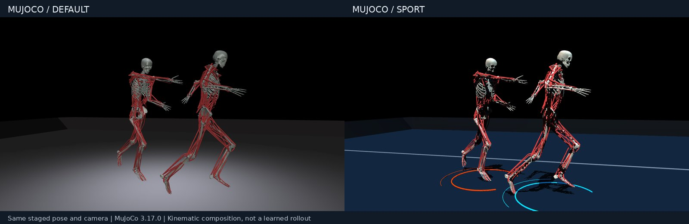

Renderer
========

Sport offscreen frames
----------------------

``MJRenderer.render_offscreen(scene="sport")`` adds a navy floor, neutral key
light, orange/cyan side lights and shadows to RGB frames. The preset only edits
the rendered scene; it leaves the shared model, simulation state, depth and
segmentation outputs unchanged. The light colours are scene accents, independent
of agent roles and activation values. For 1v1 chase-tag, sparse court lines and
broken orange/cyan identity arcs follow the two agents. These are decorative
graphics, not tag radii or trajectories. Camera settings remain explicit:

.. code-block:: python

   from myosuite.viz.mj_renderer import MJRenderer

   renderer = MJRenderer(env.unwrapped.model, env.unwrapped.data)
   try:
       renderer.set_free_camera_settings(
           distance=0.9, azimuth=103.7, elevation=-2.1, lookat=[0.15, 0, 0.92]
       )
       frame = renderer.render_offscreen(width=640, height=360, scene="sport")
   finally:
       renderer.close()

The generic ``MJRenderer`` default remains ``scene="default"``. The 1v1 chase-tag
task selects sport styling automatically for ``env.render()`` in ``rgb_array``
mode. To use its original appearance, override the task setting at construction:

.. code-block:: python

   from myosuite import make_env

   env = make_env(
       "myoChallengeChaseTagFBVs-v0", render_mode="rgb_array", render_scene="default"
   )

Other tasks and interactive viewers keep their existing defaults. Choose frame
dimensions within the model's offscreen framebuffer.

   Default (left) and sport (right), with the same staged Breakaway pose and
   camera. Rendered with MuJoCo 3.17.0; this is a kinematic composition, not a
   learned or contact-validated chase rollout.

.. automodule:: myosuite.viz.renderer
   :members:
   :undoc-members:
   :show-inheritance:

.. automodule:: myosuite.viz.mj_renderer
   :members:
   :undoc-members:
   :show-inheritance:
