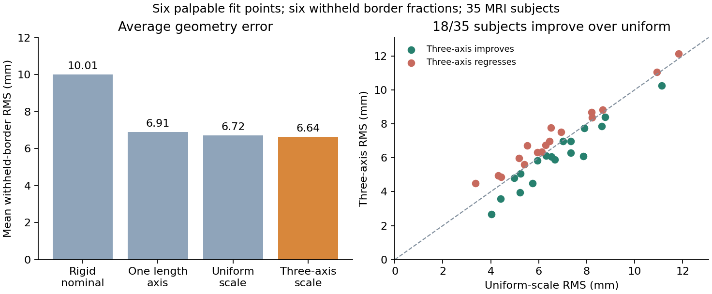

BoneHub anatomical references
=============================

Reviewed bone landmarks enter the existing :doc:`capture_scaling` and
:doc:`body_scaling` pipelines. The same subject recipe serves CPU and mjlab.

See the :download:`source-specific licence and attribution notices <../../THIRD_PARTY_DATA.md>`
for external inputs and separately licensed validation assets.

BoneHub reference data
----------------------

The `Visible Human dataset
<https://huggingface.co/datasets/BoneHub/visible-human-3d-models>`_ provides
individually labelled STL bones and IGES/STEP surfaces from two cadavers. The
`Educational Atlas <https://bonehub.github.io/Educational-Atlas/>`_ is a useful
viewer of the same data. These are anatomical examples, not a population shape
model: interpolating its male and female subjects does not establish realistic
variation in height, sex, age or body composition.

Use the opt-in reference helper to fetch only the bones needed for inspection:

.. code-block:: python

    from pathlib import Path
    from myosuite.integrations.bonehub import BoneHubReference

    reference = BoneHubReference(Path("assets/bonehub"), "01_Male")
    mesh = reference.download_mesh("LOWER_EXTREMITY_RIGHT", "PATELLA_RIGHT")
    # Existing local files: reference.mesh_path(anatomy, bone).
    print(reference.metadata())

Downloads are pinned to dataset commit
``7d520ffe410b3f79d82991b8368b2d51844feb80`` and separated by revision beneath
the chosen directory. One call downloads the requested STL and subject metadata,
not the CT volumes or the whole skeleton. ``mesh_path`` performs no download.
The dataset retains ownership of its CC BY 4.0 geometry; attribution is recorded
for Alavi and Asseln (2026, DOI ``10.57967/hf/10464``) and Andreassen et al.
(2023, DOI ``10.1038/s41597-022-01905-2``).

Load the selected geometry into 3D Slicer and annotate the landmarks required by
your measurement protocol. Save **Fiducial** markups as ``.mrk.json``. Harden any
scene transforms first so the coordinates are in the original patient frame.
Choose landmarks by a reviewed anatomical definition; mesh bounding-box ends
and surface vertices are not automatically joint centres.

.. code-block:: python

    import numpy as np
    from myosuite.integrations.capture import (
        SegmentMeasurement, estimate_marker_scales,
    )

    # Explicit example only: calibrate LPS -> your target's world frame.
    trial = reference.read_markups(
        "reviewed_landmarks.mrk.json",
        units="mm", rotation_to_model=np.eye(3),
        annotation_source="reviewer and anatomical landmark protocol/version",
        definition_license="terms applying to these landmark annotations",
    )
    measurements = [SegmentMeasurement(
        segment="femur_r", marker_pair=("RHIP", "RKNE"),
        reference_length_m=0.42, axis="y",
    )]
    result = estimate_marker_scales(trial, measurements)

The marker names, ``0.42`` m reference distance and local ``y`` scale axis are
illustrative. Derive them from corresponding landmarks on the unscaled target.
An anatomical bone measurement and a skin-marker distance require different
definitions; matching names alone does not make them interchangeable. One
distance constrains only the selected axis; cross-sectional factors remain one.
The existing estimator supports several independent axes with explicit
measurements and rejects overlapping definitions.

BoneHub's exported meshes use LPS patient coordinates (+X left, +Y posterior,
+Z superior). Its Slicer STL header declares ``SPACE=LPS``; the matching STEP
files declare millimetres. STL has no standardized unit field, so confirm units
explicitly when importing. Slicer markups may declare RAS instead: the reader
converts RAS to LPS, then applies the caller's proper LPS-to-model rotation and
metre translation. File-declared units must agree with the supplied units.
Undefined/preview points remain missing; duplicate labels, reflections and
unsupported coordinate systems are rejected.

``result.evidence["trial"]["bonehub"]`` retains subject, pinned revision,
attribution, annotation source/licence, exact annotation file hash and original
coordinate systems. The helper records the caller's subject association; it
cannot prove from coordinates which cadaver was annotated. Source height and
mass are not automatically applied to another person.

The dataset has incomplete elbow-region geometry, grouped digit phalanges and
an additional lumbar vertebra in the female subject. It does not provide a
complete muscle/tendon attachment or joint-constraint specification. For future
bone overlays, register each bone to the corresponding target body and convert
the mesh into that body's local frame before applying segment scaling. Treat
new collision geometry, inertias, muscle attachments and joint frames as
separate, validated changes to the shared CPU/mjlab model recipe.

More subjects from BoneHub VSD
------------------------------

The `VSD lower-extremity dataset
<https://huggingface.co/datasets/BoneHub/vsd-lower-extremities-seg>`_ adds 30
cadaveric cases, ages 19--95, with 63 individual bone labels, STL meshes and
subject metadata. It is derived from Fischer's
`VSDFullBodyBoneModels <https://github.com/RWTHmediTEC/VSDFullBodyBoneModels>`_.
This is a useful cohort for comparing variation beyond the two Visible Human
examples, with different terms: **CC BY-NC-SA 4.0**, including noncommercial
and share-alike conditions. The Python adapter does not bundle those meshes.

.. code-block:: python

    from pathlib import Path
    from myosuite.integrations.bonehub import BoneHubVsdReference

    vsd = BoneHubVsdReference(Path("assets/bonehub"), "001")
    mesh = vsd.download_mesh("Patella_R")
    metadata = vsd.metadata()
    print(metadata["source_subject"])  # Original VSD ID: 002.
    print(metadata["quality_flags"])
    trial = vsd.read_markups(
        "reviewed_vsd_landmarks.mrk.json", units="mm",
        rotation_to_model=np.eye(3),
        annotation_source="reviewer and anatomical landmark protocol/version",
        definition_license="terms applying to these landmark annotations",
    )
    result = estimate_marker_scales(trial, measurements)

This fetches one registered bone, the case metadata and small label dictionary
at commit ``85214b5a182b980a7869b57efba89a59a2445875``. Files are separated from
Visible Human under ``root/vsd-lower-extremities-seg/<revision>``. Subject IDs
``001``--``030`` are BoneHub case numbers; ``source_subject`` preserves the
original VSD ID. Source height/mass are recorded without becoming scale factors
or target mass automatically. The Slicer landmark reader is shared with the
Visible Human adapter and requires source metadata before importing annotations.

Fischer's source paper selects 20 complete subjects and flags ten additional
subjects with incomplete anatomy, implants, missing measurements or inconsistent
metadata. ``source_in_complete_cohort`` and ``quality_flags`` retain this
distinction in scale-estimation evidence. Even complete cases are cadaveric
examples, not a representative population distribution. BoneHub case 026 lacks
some right distal toe phalanges; case 030 lacks all phalanges. Missing bones are
not synthesized. ``vsd-feet-seg`` contains crops of these same 30 subjects and
must not be counted as independent anatomy.

VSD STL headers identify the MATLAB exporter without a standardized coordinate
or unit declaration. Its creation code uses the mesh coordinates in the source
CT physical space. Verify the mesh import and millimetre scale in Slicer; the
Visible Human ``SPACE=LPS`` header is not evidence for VSD files. Export reviewed
fiducials in their declared LPS/RAS patient frame after hardening scene transforms,
then calibrate the proper LPS-to-model rotation as above.

Other useful anatomy data
-------------------------

Primary sources reviewed on 2026-10-25 provide complementary evidence:

.. list-table:: Data for improving anatomy and scaling
   :header-rows: 1
   :widths: 24 42 34

   * - Source
     - What it adds
     - Terms and practical limits
   * - `University of Denver Visible Human
       <https://digitalcommons.du.edu/visiblehuman/>`_
     - 76 muscles, 28 bones, 16 cartilage, 8 ligament and 2 fat geometries per
       subject, with multiple processing stages and volumetric segmentations.
     - CC BY 4.0. Same two Visible Human donors; use for tissue geometry checks,
       not as additional population subjects or ready-made muscle parameters.
   * - `Keast, Bonacci and Fox tibia-fibula SSM
       <https://doi.org/10.6084/m9.figshare.20454462.v4>`_
     - Right tibia/fibula surfaces from 30 cadavers, registered points, statistical
       shape models and examples of shape reconstruction from palpable landmarks.
     - CC BY 4.0 dataset. Young adults, right side only; CT access has separate
       approval. Size, thickness and torsion modes extend beyond affine scaling.
   * - `TotalSegmentator CT v2
       <https://zenodo.org/records/8367088>`_
     - 1,228 clinical CT images with 117 labelled structures; larger variability
       in supported bones and some muscles, with a 102-case exploration subset.
     - CC BY 4.0 dataset. Anatomical coverage varies by scan; it is not a complete
       1,228-person lower-limb mesh or landmark collection.
   * - `OSSO paired body/skeleton data
       <https://osso.is.tue.mpg.de/Dataset.html>`_
     - Paired outer-body and skeleton meshes plus STAR parameters for 2,400
       UK Biobank subjects, relevant to validating surface-to-skeleton inference.
     - UK Biobank application and Tier 3 access are required. Model/software
       licences are separate; these are not freely redistributable fixtures.

For the reference workflow, use the pinned BoneHub VSD cases and reviewed
landmarks to assess segment-length variation. The tibia-fibula landmark adapter
below adds real, corresponding measurements. Nonlinear shape modes, new joint
frames and muscle attachments require separate validation.

Named tibia-fibula landmarks
----------------------------------------

``myosuite.integrations.keast`` reads explicit ``label,x,y,z`` CSV coordinates
and provides a hash-pinned local reference for Keast, Bonacci and Fox's archive
version 4. The archive contains a mean reference from 30 CT subjects and
separate landmark observations from 35 MRI subjects supplied by Nolte et al.
The six palpable labels used here are lateral/medial condyle (LC/MC),
lateral/medial malleolus (LM/MM), tibial tuberosity (TT) and fibula head (FH).

.. code-block:: python

    from pathlib import Path
    import numpy as np
    from myosuite.integrations.keast import KeastReference, read_named_landmarks
    from myosuite.core.subject_model import SubjectModelConfig, build_subject_model

    source = KeastReference(Path("local-anatomy-data"))
    # Explicit opt-in: downloads 550.6 MB, extracts under 40 KB of landmarks.
    source.prepare()
    # Reuse an existing source archive: source.prepare("SSM-tibia-V3.zip").
    target = read_named_landmarks(
        "reviewed_tibia_r_body_local.csv", units="m",
        rotation_to_model=np.eye(3), source="my unscaled target tibia_r",
        definition_source="reviewed LC/MC/LM/MM/TT/FH protocol and target version",
        definition_license="terms for my annotations",
    )
    result = source.estimate_scales(
        "C01RTF", target, segment="tibia_r", units="mm",
        rotation_to_model=np.eye(3), max_rms_m=0.01,
    )
    # spec is the exact unscaled target whose body-local landmarks were reviewed.
    subject = build_subject_model(spec, SubjectModelConfig(result.estimate))

The target CSV must express the corresponding points in **that body's local
axes**, in its unscaled geometry. Names alone do not establish correspondence
to MyoLeg sites. The source's mean shape frame is not automatically MyoLeg's
frame. The adapter estimates scale and a proper rigid pose from
the full 3D correspondences through the shared landmark fitter; it does not use
mesh bounding-box ends as joint centres. The example's 10 mm residual admission
threshold is illustrative and does not establish anatomical accuracy. The
conservative default is ``mode="isotropic"``; independent axis factors require
explicit ``mode="anisotropic"`` and evidence favouring the added complexity. Annotation
uncertainty was not provided with the source CSVs and is not invented here.

The output is the existing ``ScaleEstimate`` plus reference/observation hashes,
source definitions and residual evidence, compatible with the shared subject
model construction used by CPU and mjlab. Missing labels are explicit NaN rows;
insufficient or degenerate geometry is rejected by the fitter. The source data
cover right tibias/fibulas; left-sided correspondences need their own calibration.

Only code, checksum metadata and derivative validation reports are distributed.
Source archives, CSV coordinates, meshes and MAT model arrays remain in the
user's local cache. ``prepare`` verifies the full source SHA-256 before selective
extraction; modified cached CSVs are refused. Retain both Keast et al.
(DOI ``10.7717/peerj.14708``) and Nolte et al.
(DOI ``10.1016/j.jbiomech.2016.09.005``) attribution when using these data.

Real anatomy validation
------------------------

Reproduce the optional benchmark using an existing archive or explicit download:

.. code-block:: bash

    python scripts/validate_keast_scaling.py --data-root local-anatomy-data --download --output outputs/keast_report.json --plot outputs/keast_report.png

The benchmark fits six palpable points per MRI subject against the 30-subject
CT mean, and evaluates six **withheld border fractions**. Raw T1/T2/... and
F1/F2/... names identify digitized polyline samples whose positions/counts differ
between subjects. They are not anatomical correspondences. The adapter instead
linearly interpolates T25/T50/T75 at 25/50/75% of the MC-to-MM longitudinal
distance, and F25/F50/F75 at the corresponding FH-to-LM fractions, using each
subject's anatomically defined proximal axis. No extrapolation or surface
snapping occurs. The source paper's MATLAB reconstruction uses a different
landmark set and surface snapping; this benchmark does not reproduce that SSM
experiment.

All 35 MRI subjects are separate from the CT reference population, and border
points are not passed to the scale optimizer. Their fractions share the fitted
endpoint landmarks, so the evaluation quantities are correlated. No population
hyperparameters were fitted to these 35 subjects. The reference frame places
the origin at the condyle midpoint, +y proximally from the malleolar midpoint,
+x toward the tuberosity after removing its y component, and +z right-handed.
Both this frame and the interpolation are checked for rigid-frame invariance
and differing polyline sample counts with independently authored fixtures.

.. list-table:: Mean RMS error over six withheld border positions
   :header-rows: 1
   :widths: 42 28 30

   * - Method
     - Mean RMS (mm)
     - Worst subject RMS (mm)
   * - Nominal mean, rigid pose only
     - 10.012
     - 17.398
   * - MC-to-MM length on the longitudinal axis
     - 6.908
     - 11.689
   * - Isotropic landmark fit
     - 6.725
     - 11.836
   * - Three-axis landmark fit
     - 6.641
     - 12.119

Three-axis scaling reduces mean error by 33.7% relative to nominal, 3.9%
relative to one measured length, and 1.2% relative to isotropic fitting. It
improves 29/35 subjects over nominal, 20/35 over a single length and 18/35 over
isotropic fitting. Regressions are retained: the worst subject error is higher
than the isotropic result. More parameters do not guarantee better anatomy;
choose model complexity using additional correspondences and application-specific
validation, not the evaluation subject's withheld error.

Descriptive 95% paired-subject Student-t intervals for the three-axis mean RMS
delta are -3.370 mm [-4.591, -2.150] versus nominal, -0.266 mm [-0.574, +0.041]
versus one length and -0.083 mm [-0.342, +0.176] versus isotropic fitting. These
intervals assume independent subject deltas within this selected cohort and
do not establish representative population uncertainty. They do not demonstrate
a reliable improvement over the simpler scaling fits. The adapter therefore
keeps isotropic fitting as its default, with anisotropic fitting available for
applications that validate its added information.

The :download:`per-subject derivative report <../../myosuite/tests/data/anatomy_scaling/keast_landmark_validation.json>`
retains every fitted factor and error, including regressions, plus source hashes
and the complete protocol. This validates affine landmark geometry only.
Joint-centre placement, nonlinear bone shape, muscle paths, moment arms,
contacts and dynamics need their own checks after target construction.

Denver tissue geometry and volume constraints
------------------------------------------------------------

The original Denver Visible Human release adds muscles, cartilage and ligaments
to the same two donors used by BoneHub. ``DenverReference`` reads user-provided
final-STL and metadata ZIP archives locally. It verifies donor/side identities
inside both archives and compares enclosed mesh volumes with the independently
published final-volume tables. Reading these XLSX tables uses read-only
``openpyxl``; no source workbook or surface is rewritten or redistributed.

.. code-block:: bash

    pip install "myosuite[anatomy]"

.. code-block:: python

    from pathlib import Path
    from myosuite.integrations.denver import DenverReference

    reference = DenverReference(
        Path("vhf_final_stl.zip"), Path("vhf_metadata.zip"), "VHF",
    )
    summary = reference.summarize_geometry("VHF_Right_Bone_Tibia_smooth.stl")
    print(summary.volume_m3, summary.surface_area_m2)
    print(summary.relative_volume_error, summary.metadata())

Mesh coordinates are interpreted in the source millimetres and converted to SI
measures. A 0.1% mesh-versus-table volume discrepancy limit detects pairing or
unit errors; this is not an anatomical accuracy threshold. Open, inconsistently
wound or inward-facing surfaces supply no usable enclosed volume. Source archive
and individual member hashes remain available in the runtime evidence.

An independent volume and longitudinal length can improve a length-only recipe
by constraining transverse **area**. They cannot identify width and depth
separately. The following explicit assumption assigns equal transverse factors:

.. code-block:: python

    from myosuite.integrations.denver import (
        VolumeScaleConstraint, volume_constrained_scale_estimate,
    )

    # Supply compatible target geometry, a separately measured length factor,
    # and the target-local axis. The illustrative y axis is not inferred here.
    constraint = VolumeScaleConstraint(
        subject_id="reviewed-subject", segment="tibia_r",
        reference_volume_m3=measured_reference_volume_m3,
        observed_volume_m3=measured_subject_volume_m3,
        longitudinal_factor=measured_length_factor, axis="y",
        reference_source="reviewed target geometry and hash",
        observed_source="reviewed subject geometry and hash",
    )
    result = volume_constrained_scale_estimate(
        constraint, assume_equal_transverse=True,
    )

Each transverse factor becomes ``sqrt(volume_ratio / longitudinal_factor)``.
The resulting ``ScaleEstimate`` feeds the existing subject builder. Use matched
tissue definitions and a calibrated target body axis; an individual muscle or
bone volume is not automatically a body-mass or strength measurement. This
constraint supplies neither a muscle fibre/tendon parameter nor evidence that
the two transverse dimensions actually scale equally.

.. code-block:: bash

    python scripts/validate_denver_geometry.py --female-mesh vhf_final_stl.zip --female-metadata vhf_metadata.zip --male-mesh vhm_final_stl.zip --male-metadata vhm_metadata.zip --output outputs/denver_validation.json

The default command emits only aggregate source-volume checks. An optional
constraint demonstration requires **both** ``--longitudinal-factor`` and
``--axis`` explicitly; neither is inferred or assigned a default. Equality of
the constructed volume ratio is a mathematical consistency check, not an
independent anatomical validation.

The :download:`derived Denver report <../../myosuite/tests/data/denver_geometry/validation.json>`
records the actual 256 STL files, 128 per donor: 76 muscles, 28 bones, 16 cartilage
and 8 ligaments each. These particular archives contain no fat surfaces. Of the
256 meshes, 255 provide consistently wound usable enclosed volumes; one female
cartilage mesh is excluded. The admitted volumes agree with published tables
within ``1.35e-7`` relative error. The committed report contains aggregate
measures, quality exclusions and hashes, without source STL files, source
workbooks, per-geometry source-volume rows or an assumed length-factor example.

VSD cohort geometry reference
----------------------------------------

``scripts/validate_vsd_geometry.py`` uses the right tibia meshes from all 20
source-complete VSD cases to derive a small population plausibility reference.
Source quality is checked before admitting geometry. Closed, consistently wound,
outward-facing meshes provide solid enclosed volume and geometric spans along
the volume-inertia principal axes. The largest span is a pure outer-mesh
descriptor; it is **not** a joint-centre distance or an anatomical segment length.

.. code-block:: bash

    python scripts/validate_vsd_geometry.py --data-root local-vsd-data --units mm --download --output outputs/vsd_tibia_summary.json

Downloads are explicit and pinned through ``BoneHubVsdReference``. Omit
``--download`` to use the cache; missing cases appear in coverage counts.
``--cases`` can select a subset, whose coverage remains explicit. Units must be
confirmed by the caller. The benchmark's original 20 meshes occupy about 30 MB
locally; they are not distributed with MyoSuite.

All 20 requested meshes passed the source-completeness and enclosed-volume
checks. Median enclosed solid volume is 352.280 cubic centimetres. The
dimensionless volume divided by largest principal span cubed has median
``0.005552`` and 5th--95th percentiles ``0.004934``--``0.007011``. Such summaries
can flag implausible reference geometry or dimensional/unit mistakes during
inspection. They are not automatically applied as patient measurements,
population priors, scale factors or strength parameters, and this selected
cadaveric cohort does not establish a representative human distribution.

The :download:`derived VSD cohort report <../../myosuite/tests/data/anatomy_scaling/vsd_tibia_population_summary.json>`
contains aggregate quantiles, coverage, source file hashes and the precise
geometric protocol. It contains no vertices, centroids, per-person geometry
values or raw anthropometry. Source attribution and CC BY-NC-SA 4.0 terms are
retained for the derived VSD report separately from the software licence.

The VSD numerical summary in this section and its downloadable JSON report are
adaptations under `CC BY-NC-SA 4.0
<https://creativecommons.org/licenses/by-nc-sa/4.0/>`_, separately from the
Apache-2.0 implementation. Credit Alavi and Asseln (2026),
`doi:10.57967/hf/10471 <https://doi.org/10.57967/hf/10471>`_, and Fischer (2023),
`doi:10.1038/s41597-023-02669-z <https://doi.org/10.1038/s41597-023-02669-z>`_.
The changes are computed cohort geometry summaries and quality checks.
Sources and summaries are supplied without warranties; see the licence's
`legal terms <https://creativecommons.org/licenses/by-nc-sa/4.0/legalcode.en>`_.
No endorsement is implied. The repository's ``THIRD_PARTY_DATA.md`` inventories
the separate report and plot licences and full source attribution.
