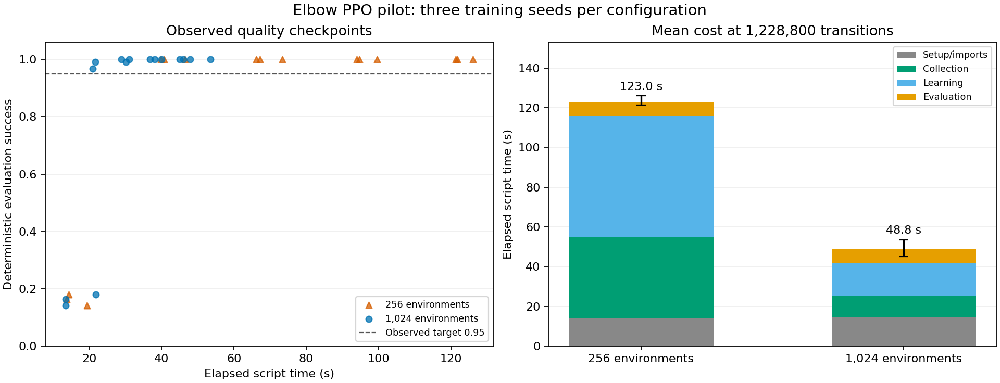

# Measured elbow PPO performance pilot

On this RTX 4090, increasing parallel environments from 256 to 1,024 reduced mean
time for 1,228,800 transitions from 123.0 s to 48.8 s. Every final policy scored
128/128 deterministic evaluation episodes. This is a bounded experiment on
`myoElbowPose1D6MRandom-v0`, not a full-body training-speed claim.

## Results

Three training seeds per configuration, 12–13 November 2026. Intervals are 95%
percentile bootstrap intervals over training seeds, with 2,000 resamples.

| Environments | Total script wall s, mean [CI] | Collection s | Learning s | Torch peak MB | Final observed success |
|---|---:|---:|---:|---:|---|
| 256 | 123.0 [121.3, 126.0] | 40.54 | 61.21 | 32.2 | 128/128 for each of 3 seeds |
| 1,024 | 48.8 [45.1, 53.5] | 10.64 | 16.38 | 70.4 | 128/128 for each of 3 seeds |

The ratio of mean times is 2.52. Mean paired-seed speed ratio is 2.54, with a
seed-bootstrap interval [2.27, 2.80]. Three seeds provide exploratory evidence;
identical observed final scores do not prove population success of 100%.

The first checked score at or above 0.95 occurred at 39.8–46.4 s with 256 envs,
and 21.0–30.1 s with 1,024 envs. These are first observed crossings, with no
interpolation between sparse evaluations.

## Protocol

Both configurations use registered task/physics defaults and the existing
`MjlabOnPolicyRunner`: 24 rollout steps, 8 learning epochs and 8 minibatches.
At the same transition budget, 256 envs perform 200 iterations and 1,024 perform
50. Batch size changes optimizer updates per transition as well as runtime.
The result supports testing 1,024 envs for this task; it does not establish a
universal default or identical learning dynamics.

Each seed uses a separate 64-env evaluation scene, 2 episodes per env,
deterministic actions and seed `100000 + training_seed`, following the registered
play distribution. Torch CPU/CUDA RNG states are restored after evaluation.
Policy weights are seeded after env construction, giving matched initial
policies across configurations. Evaluation occurs before training and at the
nearest update to 25/50/75/100% of budget; actual coordinates are retained.

## Scope and reproduction

Hardware: RTX 4090, i7-14700KF, Windows. Source `3d118ee3`, published myo-sim
0.2.5 assets, Torch 2.14.1+cu132, mjlab 1.6.0, MuJoCo/Warp 3.11.0, RSL-RL 5.4.2.
One Torch/OpenMP/MKL thread. Fresh processes, existing Warp disk cache, desktop
applications open. No early stopping or precision/solver/contact simplification.

Script time includes imports, setup and evaluation; OS/Python bootstrap is
excluded. Stage times use RSL-RL's wall clock. Torch peak memory excludes
Warp/driver allocations. Setup and evaluation are substantial in the shorter run.

[Run measurements](../validation/training-speed-pilot.json) retain model identity,
versions, protocol and all six curves. [Performance cards](performance-cards.md)
preserve censoring and explicit clock/memory scopes. The one-off driver and full
logs are in the working checkout under `tasks/implement-scaling-walk-20261112/`.
It wraps the existing runner logger and reuses
`scripts/train_mjlab.py:deterministic_success` with the settings above, offline.
Repeat on the target body and held-out motions before adopting these settings
for locomotion or SuperMimic.
